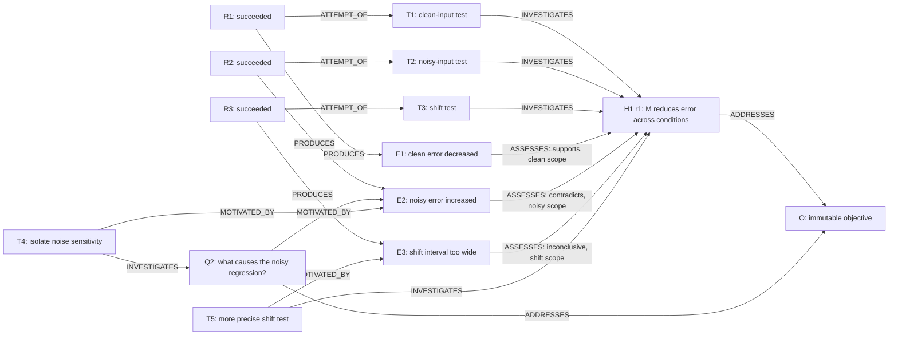
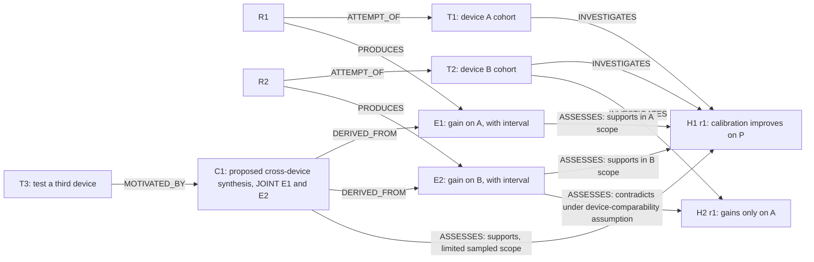
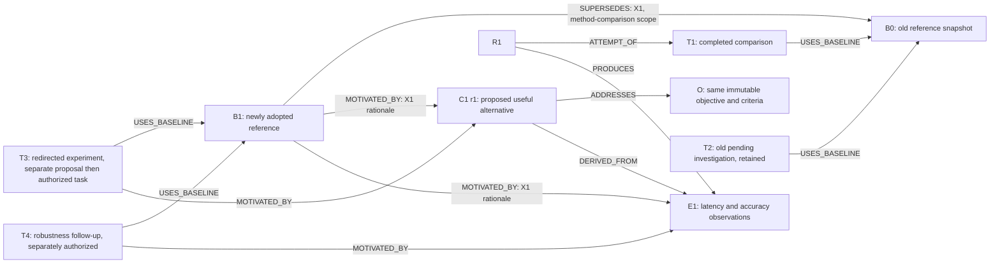

# VS-003 proposal — Research Graph data model and operations

**Status: Proposed; not approved.** Prepared 2026-11-10 from the current VS-001/VS-002 implementation.

**Authority:** Design only. This document authorizes no implementation, migration, research, network requests, model calls, spending, new workers, or automated approval. Candidate names and storage layouts below are discussion vocabulary, not public interfaces or accepted architecture decisions.

Throughout this proposal, **Principle** means an accepted project requirement, **Fact** means behavior found in the current repository, **Recommendation** means a proposed choice, and **Review decision** means an unresolved choice requiring human approval. Statements in recommended-model sections describe proposed behavior, not implemented features.

## 1. Problem definition and design goals

**Principles:** The ultimate question, success criteria, and permissions are human-owned and immutable once imported. The subordinate portfolio can expand without a predetermined size. Intermediate evidence can guide exploration without meeting final evidence standards. Baseline changes preserve objectives and observations. Research allocation and execution scheduling are separate responsibilities (ADR-001–005).

The Research Graph should explain why an investigation exists, what it investigated, which attempts produced observations, how those observations were interpreted, and what changed afterward. Its subject is the recorded reasoning and provenance of research. A dependency graph alone answers only when work is eligible to run.

**Recommendation:** Use a typed research graph alongside the existing execution DAG, sharing authoritative record identities. Store new semantic records and their history in the same SQLite database. Expose a combined read projection when useful, with relationship category and trust status always visible. Graph mutations have no scheduling effect.

Design goals:

- Make the objective structurally distinct from every agent-editable idea and baseline.
- Permit many-to-many reasoning: branches, synthesis, competing interpretations, and reused evidence.
- Preserve the difference between a recorded output, an interpretation, a reviewed assessment, and a charter-qualified conclusion.
- Explain both what the system believed at a previous revision and why later corrections changed that view.
- Reuse existing facts without copying their authority into a second store.
- Support local, incremental updates and bounded traversals; avoid reviewing the whole portfolio after each finding.

**Non-goals:** Scientific causal inference, truth determination, final-evidence certification, prediction, allocation algorithms, resource scheduling, autonomous baseline selection, substantive research, and VS-005 monitoring/navigation/UI. Mermaid examples are explanatory documentation, not a visualization implementation.

## 2. Existing implementation and gaps

**Facts**, checked against [repository instructions](../AGENTS.md), [README](../README.md), [project charter](../docs/project-charter.md), [architecture](../docs/architecture.md), [VS-001 interfaces](../docs/interfaces.md), [VS-002 interfaces](../docs/interfaces-vs002.md), [decisions](../docs/decisions.md), [current state](../docs/current-state.md), [VS-001 task](VS-001.md), [VS-002 task](VS-002.md), and the historical [VS-002 proposal](VS-002-proposal.md):

| Existing authority | Implementation facts | Reuse and gap |
| --- | --- | --- |
| Study charter | `arf/store.py`: one study per DB; original bytes, SHA-256, parsed question/criteria/constraints; update/delete guards; changed-byte reimport refused | Authoritative ultimate objective. No separate writable objective needed. |
| Executable task | `tasks` stores immutable specification and mutable execution status; `(study_id, task_id)` is unique; insertion sequence determines FIFO | Reference it as an investigation. No scientific motivation or hypothesis link exists. |
| Execution dependency | `dependencies` links dependent task to prerequisite; immutable; same study, no missing/self/cyclic references; scheduler requires succeeded prerequisites | Keep authoritative execution DAG. It expresses no scientific support or derivation. |
| Attempt and output | `runs` stores each attempt and measured costs. A running row may be finalized/recovered; completed rows cannot be updated/deleted | Use run identity for attempt-specific provenance. Failed/interrupted attempts are not successful evidence. |
| Evidence | One evidence row per successful run; matching result enforced; input/worker/charter/run provenance retained; `validation_status` is constrained to `unvalidated` | Reference original observation. No support/contradiction, applicability, independent validation, or interpretation revisions exist. |
| Planning artifacts | `arf/plan_store.py`: immutable contexts, requests, results, proposals, decisions, receipts; invalid/uncertain requests remain diagnostics | Reuse exact bytes/hashes and request provenance. Schema validity is not scientific validity. |
| Research note | A `research_note` is a tagged action inside `plan_proposals.envelope`, not a separate note table; kind is `question` or `hypothesis` | Durable inert text, with rationale and evidence references. No stable research-idea lifecycle beyond immutable proposal identity. |
| Authorization/import | `arf/authorization.py`: decisions apply only to task candidates, exact binding and strict freshness; task plus receipt commit atomically; receipt replay precedes rechecks | Preserve execution authority. Notes/no-action cannot be decided or imported through this path. |
| Context identity | Export v1 hashes canonical study/tasks/runs/evidence, excluding all planning tables and export time; 1 MiB complete-context limit | Graph-aware context requires a separate reviewed contract; adding fields would change existing hashes. |

`arf/plan_models.py` separates proposal content identity from task-action identity. `arf/planning.py` preserves raw response/prompt/provider/policy provenance and does not recall uncertain requests. `arf/service.py` and `Store.claim_next` implement the fixed-worker lifecycle independently of planning. Existing tests cover migration, freshness, immutable history, concurrency, recovery, and inert notes.

**Gaps:** No first-class subordinate idea revisions, scientific claims, baseline snapshots, reasoning relationships, assessment history, or recorded portfolio transitions. Evidence citations in proposals establish only that IDs were cited. There is no live Research Manager or general evidence validation mechanism. The current-state document contains historical handoffs; its leading verified VS-002 section supersedes older statements that VS-002 was pending.

## 3. Candidate graph models and trade-offs

| Model | Benefits | Costs / failure modes | Assessment |
| --- | --- | --- | --- |
| One graph for execution and research, with typed edges | Uniform traversal; one endpoint vocabulary | Scheduling could accidentally consume motivation/support links; generic updates could mutate immutable prerequisites; encourages an inappropriate global DAG rule | Viable only with strict disjoint write paths and projections; little benefit over the next option initially |
| Separate execution and research relations, shared identities, combined read projection | Preserves scheduler authority; reuses existing records; graph can contain reasoning cycles; easy incremental adoption | Readers must request the intended layer and retain provenance | **Recommended** |
| One tree rooted at the study question | Simple display and ownership | Cannot represent converging evidence, shared investigations, joint motivation, or competing baselines without duplication | Reject |
| General hypergraph / argumentation engine | Explicit conjunctions and rich inference | New algebra, inference and storage abstractions before a concrete scientific policy exists | Defer; small explicit premise sets suffice initially |

Separate relations need not mean separate databases or duplicate nodes. `Task(study, id)` names the same task in both layers. The execution graph remains a DAG. Research relationships are interpreted only by graph services; scheduler code continues reading `dependencies` and task statuses.

**Review decision:** Approve this separation and the rule that no semantic relationship changes execution eligibility. A later policy may consume graph queries, but must submit independently authorized actions through existing execution boundaries.

## 4. Recommended node taxonomy

**Recommendation:** Six storage families cover seven scientific roles plus execution attempts. Do not create a table for every noun.

| Graph role / notation | Persistent authority and identity | Mutability and meaning |
| --- | --- | --- |
| Ultimate Research Question `O` | Typed reference to `studies`, bound to study ID and exact charter hash | Exactly one per study. Question and criteria are read from the charter. No editable objective body or replacement operation. |
| Subordinate Question `Q` | New `idea` identity, immutable `kind=question`, immutable revisions | Open inquiry, never evidence. Multiple parents or no decomposition parent are permitted. |
| Hypothesis `H` | Same `idea` family, `kind=hypothesis` | Testable proposition with scope/assumptions; starts unresolved. Revision does not establish truth. |
| Finding / Claim `C` | Same `idea` family, `kind=claim` | Stated interpretation or synthesis. “Discovery” is an informal description of a claim, not a validated node type. |
| Experiment / Research Task `T` | Typed reference to existing `(study_id, task_id)` | Represents an authorized stored task specification, not an attempt. Current implementation still permits only `demo_mean`. |
| Attempt `R` | Typed reference to existing `run_id`, with matching study/task | Necessary to distinguish retries, failures, and actual producing attempts. No copied run lifecycle. |
| Evidence `E` | Typed reference to existing `evidence_id`, with matching study/run | Immutable captured observation and original validation label. No graph-synthesized evidence rows. |
| Baseline `B` | New immutable baseline snapshot ID | A reference method/configuration plus assumptions, applicability scope and exact referenced idea revisions. Does not contain or override success criteria. |

The six families are objective references, ideas, task references, run references, evidence references, and baselines. A small reference registry can enforce endpoint typing without copying authoritative bodies. Proposal/request/context IDs are provenance references, not additional scientific nodes. An unimported task candidate stays a proposal, not an executable-task node.

Each new identity is controller-assigned and study-scoped, with a stable opaque ID independent of text hashes. Referenced legacy IDs retain their original meaning. Idea revisions carry a revision ID/ordinal, previous revision, exact text, scope, explicit assumptions, optional structured uncertainty, author provenance, and rationale. A hypothesis changed into a claim becomes a **new claim identity** with derivation links; changing the kind of an existing idea is forbidden. Equivalent text is not scientific equivalence.

A revision may list an explicit `premise_set` of pinned evidence/idea revisions with `mode=joint` or `mode=independent_contributions`. This is a bounded argument description, not executable logic. For example, a synthesis claim can require E1 and E2 jointly; two independent supports must not be silently turned into a conjunctive argument or vice versa.

Idea lifecycle (`open`, `paused`, `abandoned`, `retired`) is independent of epistemic status and task status. Prioritization is outside VS-003. Retirement retains all content and connections. Combining ideas creates a new idea with explicit source links; splitting one creates several. Neither operation changes the objective.

**Structural protection:** Registry constraints permit only a study-backed objective reference, unique per study. No idea revision, baseline, supersession, retraction or retirement operation may target the objective as an editable subject. Scope queries always obtain the objective and criteria from the same imported study; they never choose a root using graph rank, labels, or active-baseline metadata. Semantic relevance still requires judgment: an agent can write an irrelevant subordinate idea even when it cannot replace the objective.

## 5. Recommended relationship taxonomy with precise semantics

**Recommendation:** The following is a closed initial vocabulary. Revisions of semantic links pin their exact idea revisions and immutable baseline IDs; task links pin immutable specifications. There are no implicit inverses or transitive scientific entailments. Directions below are literal arrows, not necessarily time order.

`I` means Q/H/C. Every relationship is same-study. Authoritative foreign-key provenance and interpretive reasoning are different categories even in a combined view.

| Type | Source → target | Precise semantics and category |
| --- | --- | --- |
| `DEPENDS_ON` | T → T | **Execution dependency:** source cannot run until target succeeds. Read projection of the existing dependency row only. |
| `ATTEMPT_OF` | R → T | **Factual provenance:** this exact recorded attempt belongs to that task. Derived from `runs`; exactly one target per run. |
| `PRODUCES` | R → E | **Factual provenance:** this successful attempt recorded this observation. Derived from matching evidence/run records, never from task success text. A convenience T-to-E path traverses incoming ATTEMPT_OF then PRODUCES; no duplicate T-to-E edge. |
| `ADDRESSES` | I → O or Q | **Declared research scope:** source is intended to contribute to the target inquiry. This is neither a causal assertion nor evidence that it does contribute. Shared/multiple targets are allowed. |
| `INVESTIGATES` | T → I | **Declared experimental intent:** task is intended to explore a question or test a proposition/claim, under stated scope. Does not mean it ran or that its design is adequate. |
| `MOTIVATED_BY` | I, T or B → I, E or B | **Attributed decision rationale:** the author reports that the target influenced proposing the source or adopting that baseline. Each edge records a contributing reason, not necessity, sufficiency, or an independently established cause. |
| `DERIVED_FROM` | I → I or E | **Interpretive content lineage:** source text/argument was formulated from target content. Unlike motivation, this concerns the content of the idea, not the decision to investigate. No automatic evidential support follows. |
| `ASSESSES` | E or C → H or C | **Interpretive assessment:** under recorded assumptions/applicability, source contributes `supports`, `contradicts`, or `inconclusive` toward the exact target revision. Polarity is required; no separate synonymous SUPPORTS/CONTRADICTS types. |
| `USES_BASELINE` | T → B | **Declared comparison/design context:** task specification was interpreted relative to this immutable baseline, with a scope/role (e.g. comparator). Does not prove that a run actually used it; factual implementation details remain in execution provenance. |
| `SUPERSEDES` | I → I of the same kind, or B → B | **Recorded replacement:** distinct source identity takes over the target's role within an explicit scope. Idea replacement is administrative, not refutation. Baseline replacement is derived only from a committed transition record. No endpoint can be O, T, R or E. |

`SUPERSEDES` is for distinct identities, not ordinary revisions of one idea. Baseline comparisons that coexist need no supersession. Investigating a hypothesis and being motivated by a surprising output are distinct relations; do not add both automatically. A claim can support another claim only as a declared argument with traceable original premises, never as a substitute observation.

No `CAUSES` relationship is introduced. An independently studied scientific causal mechanism is represented as a scoped hypothesis/claim with evidence, methods and assessments; it cannot be established by an author's motivation statement, temporal succession or correlation. Even a reviewed MOTIVATED_BY link validates an attribution only within the stated review scope. Trusted execution provenance establishes record linkage, not causation in the scientific domain.

The following table supplies the remaining governance rules for **every type**. “Controller” means installed trusted code enforcing capability and record checks, not an AI claiming to be trusted.

| Type | Permitted creation and validation / authorization | Revision, invalidation and effects |
| --- | --- | --- |
| DEPENDS_ON | Existing trusted task creation/import only; current validation and execution authorization unchanged | Existing rows immutable. Graph cannot revise/retract. Only this type affects scheduling. |
| ATTEMPT_OF | Controller read derivation from existing FK; no agent creation | Cannot retract an authoritative fact. A bad projection is corrected in projection code/index, retaining its observation audit. No allocation effect. |
| PRODUCES | Controller read derivation; existing successful-run/result checks required | Same factual rule. Failed/interrupted runs have no such edge. No epistemic promotion or scheduling effect. |
| ADDRESSES | Human or controller may register agent-authored proposals; validate types, scope and charter binding | New edge revision / withdrawal; human can correct. Records intended scope only; no funding or queue effect. |
| INVESTIGATES | Same semantic proposal boundary; target revision and task must exist | Revision/retraction changes recorded intent only. Does not modify spec, dependencies or results. |
| MOTIVATED_BY | Same boundary; record author, time, pinned source context and rationale. Later attribution must be labeled retrospective | Revision/retraction preserves earlier explanation; cannot establish causation. No automatic task creation or allocation. |
| DERIVED_FROM | Same boundary; explicit content references/premise set. Agent assertion is not independently verified provenance | Revision/retraction; downstream arguments may need reassessment. No inferred scientific validity or queue effect. |
| ASSESSES | Agent/human may propose; trusted controller validates structure. Only distinct human/trusted reviewer can record a review; reviewer scope/method must be stated | Revise assumptions/polarity via a new revision, or retract. Review never promotes original evidence or certifies final science. No task/baseline action. |
| USES_BASELINE | Human/controller registers declared intent, or derives it only from a future explicitly versioned trusted task contract; current TaskSpec has no such field | Revision/retraction does not rewrite executed configuration. Disagreement with run provenance must remain visible. No scheduling effect. |
| SUPERSEDES | Idea replacement: explicit scoped semantic operation. Baseline replacement: separate authorized transition with predecessor check and receipt | Withdrawal/correction is append-only; baseline rollback is a new transition. Never invalidates observations or cancels tasks. |

For semantic rows, “register agent-authored” permits recording unreviewed assertions, not self-authorization or a live agent integration in this milestone. Section 6 defines capabilities. There is no requirement for humans to review each proposed edge; consequential transitions have narrower approval gates.

**Cycles:** DEPENDS_ON retains the existing execution DAG constraint. SUPERSEDES is acyclic within each replacement scope, and each revision chain is linear with an expected-head check. DERIVED_FROM plus explicit premise references must form a DAG over exact content revisions, checked on insertion; pinning existing endpoints alone would not prevent circular lineage. New content may cite old content, never an unknown future revision. Mixed research cycles are permitted: Q MOTIVATED_BY E, E ASSESSES C, and C ADDRESSES Q form a directed cycle with three distinct meanings. Reciprocal claim assessments may also be recorded as unresolved interpretations; reject self-links and never interpret a cycle as proof. No whole-graph acyclicity check. Traversals require visited sets and budgets; a budget-exhausted constraint check must refuse the write rather than assume acyclicity. Cyclic claim assessments cannot validate each other without original evidence.

## 6. Data ownership and authorization

**Principles:** The human owns the charter and final success criteria. Execution approval remains independent of graph registration. Agent text cannot grant capabilities.

**Recommendation:** Separate operations by capability, even if one local service hosts them:

| Capability | Authority and boundary |
| --- | --- |
| Read study / graph | Controller supplies bounded snapshots with provenance; no implicit tools, credentials, DB handle, or arbitrary file access for a planner |
| Propose subordinate content / links | Agent may propose new/revised/combined/abandoned ideas and semantic edges; controller assigns IDs, checks references and limits, and records them as agent-authored/unreviewed |
| Correct or review interpretation | Human or explicitly authorized trusted reviewer appends an exact-content review/correction; proposer cannot manufacture reviewer identity/status |
| Execute work | Current VS-002 operator decision + import + separate run-next; graph registration is insufficient |
| Activate baseline transition | Explicit trusted operator action in the minimal scope; binds exact baseline/transition contents, current predecessor, scope and evidence references |
| Certify a final conclusion | Not implemented by VS-003. Requires later reviewed procedure bound to original charter criteria; no generic “validated=true” write |

Future autonomous research management can receive delegated permission to manipulate the subordinate proposal portfolio without human review of each idea. That delegation must not allow execution approval, evidence rewriting, charter editing, or final certification. The initial implementation should exercise data-only inputs through trusted offline fixtures/operator calls, without automated scientific approval or a live manager.

Every mutation records actual author/source and controller separately. A delegated agent may revise or withdraw its own unreviewed assertions; changing reviewed content creates a new unreviewed revision and cannot erase a trusted decision. Corrections to other authors' assertions require trusted authority or a separately attributed alternative. Locally asserted operator identity remains the current trust model, not authenticated human identity. Permissions are enforced by code paths, foreign keys, checks, and immutable-history guards; not by prompt instructions or a model-supplied role string. Host/database owners remain trusted.

## 7. Evidence and epistemic status

**Facts:** A successful fixed worker emits a validated numerical result structure, then stores evidence labeled `unvalidated`. This establishes a recorded observation, not a general scientific fact or conclusion. There is no evidence-promotion API.

**Recommendation:** Keep three independent dimensions:

1. **Origin and observation:** original immutable result, run/input/worker/charter linkage, known measurement uncertainty, and gaps. Unknown uncertainty remains unknown; never fill it from model confidence.
2. **Interpretation:** an exact ASSESSES revision, including polarity, rationale, target revision, applicability domain, assumptions, uncertainty description, and the explicitly used premises. Different assessments of the same evidence coexist.
3. **Review:** who examined that interpretation or observation, how, when, against which scope/content hash, and with what limitations. `proposed`, `reviewed`, `rejected` are review states, not truth labels; withdrawal/supersession is a separate lifecycle.

Observed evidence, proposed interpretations, supported arguments, contradicted arguments, and unresolved hypotheses remain distinguishable in queries. A view may say “has proposed supporting assessments,” “has reviewed contradictory assessments,” “mixed,” or “no applicable tests.” It must return the underlying assessment IDs and qualifications. Edge counts, majority vote, graph centrality, and model confidence are not automatic validation rules. Inconclusive evidence is an explicit assessment; absence of an edge means no recorded assessment, not a negative result.

Evidence can support H1 under assumption A and contradict H2 under assumption B. Store those as separate assertions; do not assign one global polarity to E. A new hypothesis revision receives no automatic transfer of old support. A read view can show prior-version assessments as potentially relevant, clearly marked for reassessment.

Joint support uses an explicit synthesis claim C with pinned E1/E2 premises and DERIVED_FROM links. An ASSESSES edge from C to H means “this proposed joint argument bears on H”; the C-to-E1 lineage alone does not assert that either premise suffices. A missing/retracted premise makes the argument require reassessment; it does not erase historical reasoning. Shared datasets/calibration and other dependence must be recorded in provenance/assumptions when known. Distinct run IDs do not establish independent experiments.

Optional append-only observation reviews can reference E without changing its original `unvalidated` column. The smallest scope may defer these and implement only interpretation reviews. Neither choice establishes a scientific validation authority. Defective evidence remains in history with a linked warning/review; no deletion, result editing, or relabeling to make a conclusion pass.

Final conclusions must trace to original observations and satisfy the **unchanged** charter success criteria. VS-003 offers no “study complete” operation and cannot enforce scientific sufficiency merely from structural constraints. A later certification record would need the charter hash, each criterion, exact premises/assessment versions, method, reviewer authority and unresolved limitations; its procedure is a separate approval decision.

## 8. Graph evolution, provenance, and historical reconstruction

**Recommendation:** Immutable content revisions plus small append-only decision/lifecycle records, rather than a general event-sourced platform.

- Stable node/edge IDs name logical objects. Revision IDs pin exact content. Changing endpoints, assumptions, rationale, polarity, or premise set appends a new edge revision. Old reviews remain attached to old revisions.
- Each semantic mutation belongs to an atomic change batch with a monotonic committed sequence, study/charter binding, actor/source, recorded UTC time, request idempotency key and canonical payload hash. Times are local observations; sequence orders commits, not scientific causality.
- Revision chains and reviews use expected-head checks inside a write transaction. Identical operation-key/content replay returns the original receipt; conflicting key reuse fails. Separate agents can disagree through distinct edge IDs rather than overwriting each other.
- Withdrawal, rejection, retirement and supersession append records. Current state is a deterministic SQL view of latest revisions plus applicable decisions. A reviewed edge edited later becomes unreviewed at the new revision; review does not transfer implicitly.
- Per-edge provenance includes proposal/request IDs when available, exact context hash, source revision IDs, provider/prompt/policy identity already recorded in planning, rationale, and whether the explanation was contemporaneous or retrospective. Controller registration time is not model generation time or proof of actual internal reasoning.
- Human correction may reject one assessment and append an alternative without deleting the author’s original assertion. A retracted rationale is still visible in historical ancestry queries.
- Dependency impact queries return a bounded set of possibly affected assessments/ideas/tasks, with paths and reasons. They may flag `requires_reassessment` as a derived advisory condition. They do not recursively rewrite every conclusion, require global review, or automatically stop tasks.

An ordinary idea edit stays within one identity and linear revision chain. A substantive alternative can instead receive a distinct identity. Combining/splitting identities uses DERIVED_FROM plus optional scoped SUPERSEDES, with the decision recorded explicitly. Baseline snapshots are immutable; a changed baseline is a new snapshot, not a new body under the old ID.

**Baseline transitions:** Use a small auxiliary transition record, not a new scientific node. It contains scope, old baseline (null only for initial activation), new baseline, exact motivating evidence/claim revisions and rationale, author/authorizer, expected predecessor transition, recorded time, and per-task/idea dispositions such as `retain`, `redirect_proposed`, or `pause_direction`. A committed transition projects Bnew SUPERSEDES Bold only within that scope. Rationale may project MOTIVATED_BY links with the transition as provenance. An inactive candidate baseline has no active transition.

The active baseline is computed per named scope from committed transition order; competing scopes may coexist. Baseline content must match the transition scope. Redirecting an existing executed task means proposing a new task under the new baseline, preserving the old task/spec/results. Pausing a direction is portfolio metadata. **It does not cancel a pending executable task**, which remains FIFO-eligible under current contracts. Any future cancellation policy requires separate review.

Undoing a transition is another authorized transition (possibly to a fresh snapshot with previously used content), not deleting history. A transition's scientific rationale may later be retracted while the recorded fact of adoption remains; the system flags it for reconsideration rather than pretending it never occurred. Historical results remain usable according to their applicability, not just whether their baseline is active.

**History alternatives:** Mutable edges plus timestamp columns are too weak for overwritten interpretations/reviews. A complete operation/event log with reducers and periodic full snapshots gives powerful replay but adds event/schema evolution, reducer correctness and cache-rebuild work. Immutable revisions plus append-only decisions provide exact graph history with direct SQL and modest audit storage. Materialized current-state tables can be added as rebuildable caches if measured query costs justify them; they are not authoritative.

**As-of semantics:** A query at committed graph sequence S selects only revisions and decisions recorded by S. An assertion recorded tomorrow about last week does not appear in yesterday's view; an optional asserted occurrence time is separate from recorded time. Each endpoint retains its pinned revision and original author. Current-state and history views are explicit alternatives, not silently mixed.

Historical reconstruction is exact for **recorded graph knowledge**, not for every past execution status. Existing tasks mutate status and running attempts are finalized; the legacy DB is not a complete execution event log. Graph views may show immutable task specifications, evidence and finalized attempts once observed at a graph batch, and must label live execution status as current or unknown at S. They must not join today's task status into an unlabeled historical graph. Pre-migration relationships first appear at registration sequence, with original timestamps separately retained; do not invent historical reasoning. Existing VS-002 snapshots provide exact execution state at their captured points only. Continuous historical execution monitoring is deferred, not falsely promised here.

## 9. Integration with VS-001 and VS-002

### Research-note lifecycle and authoritative references

**Review decision:** Automatic node creation for every valid note is viable and complete, but entangles graph side effects with VS-002 proposal creation and creates many research identities the controller has not selected. A read-only projection avoids writes, but cannot give an idea an independent evolving identity. **Recommend explicit registration.**

A trusted registration operation selects a persisted valid `research_note` proposal, verifies exact kind/text/study/charter binding, and creates one untested Q/H initial revision with a receipt keyed by `(study, proposal_id)`. It records the original proposal/context/request provenance and registration actor/time. The operation is not a VS-002 task decision or import. It cannot create evidence, claims, tasks, or approvals. Repeating it returns the same idea/receipt. Notes not registered remain inspectable proposals outside the active graph.

Subsequent idea revisions leave the original envelope and receipt untouched. Similar proposals are not merged by text similarity. Combining several registered notes into one idea is a separate explicit synthesis operation with source references. A human can create a subordinate idea directly with human-authored provenance; no forged planner record is necessary. No-action and invalid/review-required requests do not become scientific nodes.

Task proposal provenance is available via `plan_receipts` after import. A graph reference resolves that task to its receipt/proposal/context without copying approval fields or introducing a second task. Proposal rationale/evidence_refs can be displayed as **stated proposal motivations**, not automatically as reviewed scientific edges. Recording an explicit semantic motivation must retain that attribution and original context. A late link is retrospective and cannot prove why the task was originally created.

ATTEMPT_OF/PRODUCES/DEPENDS_ON are derived read projections of original rows. Reference registration can be lazy or performed in explicit batches; it never executes work. The combined view must report a registration watermark/completeness boundary so absent optional registry entries are not mistaken for missing execution history. Historical backfill registers only known facts, no inferred support, motivation, independence or baseline.

### Contexts, hashes and freshness

**Facts:** `PlanStore.context_bytes()` emits export/canonicalization v1. Planning tables are deliberately excluded. `_fresh` recomputes this execution hash at first approval/import inside a write transaction. Replays return original decisions/receipts before freshness checks. The mock, strict response union, proposal hashes and task-action hash know nothing about graph revisions.

**Recommendation for compatibility:**

1. Preserve export v1 canonical bytes, limits, proposal IDs, content/action hashes and freshness exactly. A graph-only mutation does not invalidate a **legacy, graph-unaware** VS-002 candidate. Such a candidate must not be presented as having consulted the graph or revalidated a changed baseline.
2. New graph mutation requests pin a separate versioned graph context artifact: study/charter, graph sequence, exact consulted node/edge revisions, source execution context hash if used, selection manifest and canonical hash. Keep these artifacts outside existing `plan_contexts` v1; do not add fields to old envelopes or reinterpret their hashes. Context-export bookkeeping does not advance the semantic graph sequence or enter its own hash; unchanged exports and committed-operation replays do not create new semantic revisions. Registration of a note binds its original proposal plus current expected graph head; it is not a fresh scientific endorsement of that note.
3. For the first graph service, use strict graph-sequence freshness plus exact referenced content checks for a **new** mutation, serialized with its write. Replays of committed receipts precede freshness. This may reject unrelated concurrent changes, but is simple; finer read-set freshness is a later explicit choice.
4. Graph-aware executable proposals would need a new reviewed envelope/export version binding both execution and graph state, with fresh-context approval/import checks in one transaction. Do not attach a graph sidecar to a legacy approval and call it equivalent authorization. Recommend deferring this extension from the minimal VS-003 scope.

The graph store can hold thousands of nodes without requiring every planner request to include the whole graph. A bounded graph context must declare selected IDs, pinned revisions, traversal policy, omissions/frontier and completeness; never claim it is exhaustive. The objective/criteria remain exact. Limits are enforced by controller code. Oversize input fails explicitly rather than silently dropping evidence. VS-002's complete-context 1 MiB refusal remains unchanged; this proposal does not solve its long-term scaling limit.

### Migration and compatibility requirements

**Recommendation:** A later approved implementation would introduce an explicit transactional schema v3 migration from a verified v2 DB; a v1 DB first uses the existing explicit v1-to-v2 migration. No migration runs during ordinary graph reads, proposal creation, or this design assignment.

Current `Store` refuses versions other than 1/2, `PlanStore` requires exactly 2, and `plan migrate` verifies an exact known schema. Merely adding graph tables would therefore break compatibility. A reviewed implementation must add recognized v3 handling and complete schema verification while preserving existing required objects and all v1/v2 behavior; it must not simply relax unknown-schema checking. Updated binaries should still operate on unmigrated v1/v2 databases. Older binaries are expected to refuse v3 safely; backward binary compatibility and downgrade are not promised.

Migration must preserve every old row/ID/sequence/timestamp, charter byte/hash, planning blob/hash, cost/null, run/evidence label, decision and receipt. Add only graph-owned tables/indexes/guards; no old scientific data is rewritten. Test interruption rollback, repeat no-op and unknown/custom-schema refusal. Backfill of selected references/notes is a separate idempotent operation, not automatic scientific interpretation during migration. No worker, FIFO, task-state, dependency, retry/recovery or atomic-import semantics change.

## 10. Persistence options and recommendation

These are repository-relative engineering comparisons, not benchmark results or claims about a specific external product. No graph dependency is installed or required by this proposal.

| Criterion | A — SQLite relational graph | B — Dedicated property-graph database | C — Graph event log plus read projection |
| --- | --- | --- | --- |
| Implementation complexity | Typed references, revision/edge tables and SQL views; fits current code | New service/client/schema/access control/backup operations plus an integration boundary | Small log can start simply; projection/replay/schema-upgrade logic grows with behavior |
| Queries | Indexed adjacency, joins, recursive CTEs or bounded iterative traversal; scientific semantics remain application logic | Convenient variable-length paths and graph query language; provenance/temporal semantics still need modeling | Efficient only with maintained projections; raw event replay is poor for interactive ancestry |
| Transactional consistency | Graph changes and bindings in one local transaction; existing records share FKs | Separate execution SQLite and graph require outbox/reconciliation; cross-store atomicity not free. Moving execution authority would exceed scope | SQLite-hosted log can be atomic; file/external log introduces dual-write uncertainty |
| Versioning/provenance | Immutable revisions and append-only decisions directly queryable | Custom immutable revisions/review history still required; graph storage does not make claims trustworthy | Natural recorded-order history; exact reconstruction depends on versioned reducers |
| Thousands or more nodes | Plausible fit with study/type/source/target/revision indexes, pagination and bounded traversals; needs later measurement | Likely useful for much larger/deeper graph workloads; deployment cost may dominate this slice | Event count and projection write cost may exceed node count; needs compaction/cache policy without losing authority |
| Migration/maintenance | One DB/versioned migration/backup unit; familiar constraints | Two persistence lifecycles and failure modes, dependency upgrades, export and schema mapping | Replay compatibility and projection drift tests become long-lived obligations |
| Future visualization | Stable typed IDs, adjacency and versioned export are sufficient | Native graph query/export helpful, but no UI framework is implied | UI reads the projection, not the log; stable identities still required |

**Recommendation:** A, with immutable content revisions and small append-only decision batches. This uses history where needed without event-sourcing the existing executor or introducing a generic event bus. Reconsider B if measured traversals or concurrent writers exceed this local architecture; preserve a storage-independent export shape rather than an unused backend framework now. Consider C only if exact cross-component replay becomes an approved requirement.

Candidate relational responsibilities, **not approved DDL**:

| Record family | Minimum contents / invariants |
| --- | --- |
| Graph references | Stable study-scoped ID, immutable type, exactly one typed authoritative FK for O/T/R/E or one graph-owned I/B identity; unique mapping; no duplicated authoritative content |
| Ideas and revisions | Immutable kind and identity; revision ID, previous revision/head precondition, text, scope, assumptions, explicit premise references; no objective revisions |
| Baseline snapshots | Immutable identity/configuration/assumptions/scope; pinned reference rows; no executor instructions or permission fields |
| Relationships and revisions | Logical edge ID, type, exact source/target refs/revisions, category, typed polarity when applicable, rationale/applicability/uncertainty, author/context/batch; no agent-created factual execution links |
| Decisions / lifecycle | Target revision/hash, action, actor/reviewer authority, reason, batch sequence; immutable review/retraction/retirement history |
| Changes / contexts / receipts | Monotonic committed sequence, exact canonical request/hash, context selection manifest/hash, operation-key receipt; stable replay and conflicting-key rejection |
| Baseline transitions / impacts | Scope, predecessor, old/new baselines, exact reason references, authorizer, per-direction/task proposed disposition; one successor of an expected predecessor in a scope |
| Note registration receipts | Exact proposal/content binding and resulting idea/revision, unique source proposal mapping |

Use composite FKs or equivalent typed reference tables/checks to enforce study consistency and endpoint categories. A bare `(kind, arbitrary_id)` without referential integrity is insufficient. Payload JSON holds text/configuration; reference lists and pins need constrained rows so dangling premises cannot hide in JSON. SQL guards protect immutable identities/content and old authoritative tables. Trusted operation validation supplies revision-chain/cycle/precondition checks; document which invariants are SQL-enforced and which are service-enforced.

Index outgoing/incoming adjacency by study, type and endpoint; idea/edge revision chains; batch sequence; context/receipt identity; transition scope/predecessor. Use short transactions and no model/worker calls inside them. Default traversals are paginated with node/edge/depth/output budgets and explicit truncation/frontier. No all-pairs closure, mandatory whole-graph snapshots on every change, or unbounded recursive query. Size/scale targets require measurement during implementation, not an assumed performance promise here.

## 11. Worked examples and counterexamples

**All examples below are fictional design fixtures, not studies or executed experiments.** Their imagined experiments are not new authorized workers. Arrows use section 5 literally. The displayed ASSESSES polarities are proposed interpretations unless a separate review is stated; no example establishes a validated conclusion. Each T-to-E path abbreviates an actual named run only by omitting unrelated run fields, not by omitting attempt identity. O's question and criteria are fixture text, not a supplied human study objective.

### Example A — Branching research

Fixture objective O: “Can method M improve sensor accuracy across declared conditions?” Human criteria are fixed separately in the charter. H1: “M reduces error across clean, noisy and shifted inputs.” Three investigations test distinct conditions.

E1–E3 are original observations; captions such as “decreased” summarize fixture outputs and require exact metrics/uncertainty in their records. E2's negative assessment is scoped and does not refute every possible narrower H. The clean-scope support does not establish H's full cross-condition proposition. H remains unresolved/mixed. Q2 and T4 record branching exploration, not a demonstrated causal mechanism. T5 exists because an author judged E3 insufficient. There is no DEPENDS_ON unless an executable prerequisite is separately declared; graphical ancestry is not a scheduling dependency.

**Counterexamples:** A timeout in R3 would produce a failed run, no E3, and no “contradicts H” output edge. A later T6 that happens to follow T3 has no MOTIVATED_BY relationship without a recorded attribution. A proposed “H is now the ultimate question” cannot replace O; H is still subordinate even if many links point to it.

### Example B — Converging and competing evidence

H1: “M improves calibration on population P.” H2: “M's gains occur only on device A.” T1 uses device A, T2 independently samples device B with separate subjects, collection and calibration references in this fixture. A claim of independence is an assumption/provenance statement to inspect, not a property inferred from two run IDs.

C1's revision explicitly lists a joint premise set E1/E2. Its lineage edges identify sources; they are not two separate proofs of the synthesis. The individual E1/E2 assessments and C1 assessment must not be counted as three independent experiments. T3's exact scientific target would get a separate INVESTIGATES link when registered; MOTIVATED_BY alone does not assert that target.

**Counterexamples:** If T1 and T2 reused one calibration dataset, independence must be qualified and C1 revised, while observations stay intact. If comparability is disproven, retract/revise only the E2-to-H2 assessment; E2-to-H1 may remain applicable. An AI-created C1 with no observed ancestry is a proposed claim, not evidence. Two mutually supporting claims cannot bootstrap validation. If a joint premise is withdrawn, retain C1's historical argument and flag reassessment rather than silently substituting another result.

### Example C — Baseline transition with retained history

B0 is a reference implementation. T1 compares an alternative to B0. E1 records lower latency; C1 proposes that the gain is useful without losing required accuracy. Human criteria in O remain unchanged. A trusted operator commits transition X1 from B0 to B1 within scope `method-comparison`, citing E1/C1 and an explicit accuracy limitation.

X1 is an auxiliary transition/impact record underlying the scoped supersession arrow; it is not an extra scientific node. It records T1=`retain historical`, T2=`redirect_proposed`, and an older idea branch=`pause_direction`. Once separately authorized/imported, T3 is a new task, not a rewritten T2. T4 is another independently authorized follow-up; neither is created merely by drawing a baseline edge. Old B0 observations remain available for comparison or reuse under their original conditions.

**Counterexamples:** B1 activation does not cancel T2: until another execution contract is approved, T2 remains pending and runnable if its prerequisites succeed. Baseline metadata cannot lower O's accuracy requirement. A transition concurrently expecting B0 after X1 must fail its predecessor check; it cannot overwrite X1. If C1 is later rejected, X1 remains a historical adoption event and requires reconsideration; it is not deleted. Another scope may keep B0 active, so SUPERSEDES is never interpreted as a global invalidation.

### Further stress cases

- One task can investigate two hypotheses; one evidence item can have several conflicting interpretations. Duplicating the task/output to force a tree would lose provenance.
- Two findings jointly motivating a question use two contributing MOTIVATED_BY links plus an explicit joint rationale/premise set, not an invented factual causal edge.
- H r2 narrows H r1. Old assessments remain pinned to r1; current views may offer them for reassessment but cannot silently retarget them.
- A motivation added after task execution is retrospective, even if the author claims an earlier occurrence time. Historical graph views follow recorded sequence.
- Pausing a direction containing a currently running task never recovers, retries, kills, or finalizes its run.
- A graph path that repeats H/T/E is traversable with visited sets. A path of only mutually supporting claims is not an evidential foundation.

## 12. Proposed implementation boundaries

**Recommendation for a minimal implementation, only after approval:**

1. Explicit verified v2-to-v3 migration; typed authoritative references; immutable ideas/revisions/baselines; edge revisions, narrow review/lifecycle records, change receipts and registration receipts.
2. Explicit research-note registration and direct human-authored subordinate ideas; declared semantic relationships; deterministic factual execution projections. No automatic graph expansion from every planner response.
3. Append-only semantic corrections/retractions and scoped operator-authorized baseline transition/impact records. These record portfolio intent and adoption history; they never select a baseline algorithmically or alter queued tasks.
4. Bounded internal read operations for task ancestry, evidence impact, active baseline by scope, disagreement/review status, edge provenance, and graph-as-of sequence. Separate graph context artifacts with explicit selection/completeness.
5. An offline fixture harness exercising the examples and restart/concurrency/error cases; all current execution/planning behavior retained.

**Conceptual operations and authorization**, deliberately not signatures or CLI commands:

| Operation | Required behavior |
| --- | --- |
| Register question/hypothesis | Controller accepts bounded subordinate content or exact note proposal; creates unresolved idea revision, declared scope and provenance; no task or evidence |
| Connect task to motivation | Propose INVESTIGATES/MOTIVATED_BY/USES_BASELINE links to existing exact identities; record contemporaneous or retrospective attribution; cannot edit TaskSpec |
| Connect experiment to evidence | Resolve ATTEMPT_OF and PRODUCES from trusted rows only; inspect failed/interrupted attempts without manufacturing evidence |
| Assess evidence | Propose ASSESSES with polarity/assumptions/scope/uncertainty and pinned target; distinct reviewer may append review; neither can mutate original evidence |
| Create work from a discovery | Register question/hypothesis or task intent and attributed motivation; executable candidate still uses separate VS-002 propose/decide/import/run path; an unimported candidate remains provenance, not T |
| Revise or invalidate interpretation | Append content revision or rejection/retraction with exact target/hash and expected head; previous view remains reconstructable; return affected references for review |
| Record baseline transition | Trusted operator binds immutable snapshots, scope, predecessor, reasons and impact dispositions in one commit; no task mutation; replay returns original receipt |
| Traverse task ancestry | Return intent, stated motivations, exact hypothesis revisions, original proposal/context/receipt, attempts and evidence, with typed paths and review qualifications; distinguish content ancestry from prerequisites |
| Find directions affected by evidence | Reverse-traverse ASSESSES/DERIVED_FROM/MOTIVATED_BY and applicable baseline-transition reason references, then connect INVESTIGATES/USES_BASELINE; return possible impacts, paths, scope and truncation, not mandatory invalidation |

**Interface alternatives requiring review:** An internal typed service plus offline harness is smallest and avoids prematurely adding public verbs; an operator CLI makes registration/review/transitions easier to inspect but needs a new normative contract before coding. Recommend service/harness first. Likewise, legacy graph-unaware VS-002 versus a new graph-bound proposal contract is an explicit choice, not an implementation default.

VS-005 will need stable IDs/revision pins, typed filtered adjacency, full provenance lookup, as-of graph reads, change pagination/watermarks, baseline scope/history, disagreement qualifiers and bounded subgraph exports with frontier/completeness metadata. Return data, not display layouts. No dashboard, interaction design, graph rendering library, monitoring loop or UI framework is selected here.

Out of scope: live models, scientific validation engines, autonomy/authorization policies, final conclusion certification, external evidence ingestion, new workers, generated-code execution, budgets/prediction/optimization, resource scheduling, task cancellation/preemption, multi-host replication, general backend abstraction, and VS-004/VS-005 implementation.

## 13. Proposed acceptance criteria and tests

These are **future implementation targets**, not test results for a Research Graph implementation.

| ID | Required check and observable boundary |
| --- | --- |
| G1 Objective protection | Agent-supplied objective text/criteria/kind changes, objective retirement/supersession, and baselines containing objective overrides fail. Original charter row/bytes/hash remain identical after all graph operations and migration. Semantic relevance limits remain documented. |
| G2 Migration | Populated v2 migrates atomically with every old row/blob/hash/ID/sequence/null unchanged. Repeat is no-op; injected interruption rolls back; v1 prerequisite and unknown/custom-schema refusal are explicit. Updated code retains v1/v2 operation; old code safely refuses v3. |
| G3 Note lifecycle | Registration is explicit, one initial Q/H per selected proposal, unresolved and inert; restart/replay returns identical receipt. Notes/no-action remain unimportable. Invalid or uncertain requests cannot become ideas; scientific equivalence is never guessed. |
| G4 Typed semantics | Wrong endpoint types, cross-study refs, dangling revisions/premises, forged factual links, self-links and unsupported relationship names fail atomically. Revision-level derivation/premise and scoped supersession cycles fail; mixed research cycles remain representable. Several motivations and several targets work without duplication. Each taxonomy row has a direction/category/authority test. |
| G5 Evidence integrity | Only successful original runs project PRODUCES; failed/interrupted attempts remain visible but create no evidence. Conflicting/conditional/inconclusive assessments coexist, preserve unvalidated labels and unknown uncertainty, and never validate H automatically. |
| G6 Revision/review | Revised target or assessment does not inherit earlier reviews/support. Human correction/rejection/retraction preserves original authors and bytes; joint-premise changes report possible reassessment without rewriting observations. |
| G7 History | As-of sequence before/after revision, review, retraction and baseline transition reproduces recorded knowledge exactly. Late/retrospective links are absent before recording. Current execution status is never mislabeled historical; pre-registration history gaps are explicit. |
| G8 Baselines | Transition is scope-bound, preserves O and history, records reasons/affected directions, and allows reuse of old results. Concurrent same-predecessor transitions conflict; replay is idempotent; uncertainty/crash does not double-apply. Pause/redirect intent leaves pending/running tasks and dependencies unchanged. |
| G9 Execution compatibility | Full VS-001/VS-002 regressions pass on supported versions including migrated v3; fixed worker/FIFO/claim/finalization/retry/recovery/import behavior unchanged. Adding semantic cycles does not block ready tasks. DEPENDS_ON cycles still fail. |
| G10 Context compatibility | Graph-only writes leave legacy export v1 bytes/hash and task proposal/action identity unchanged; execution changes still stale first approval/import. Committed decision/receipt replay still precedes freshness. Graph contexts change when their defined graph state changes, carry selection/frontier, and reject stale first mutations without changing old contexts. |
| G11 Transactions and idempotency | Concurrent revision writes cannot fork a logical head silently; conflicting operation-key reuse fails; injected failure at batch/revision/receipt boundaries leaves all-or-nothing graph state. No provider recall, experiment retry or execution occurs. |
| G12 Examples and scale | Offline fixtures encode A/B/C, joint synthesis, shared evidence and counterexamples. A deterministic synthetic fixture with at least 10,000 graph nodes exercises paginated ancestry/impact/history queries with high-degree branches and cycles; bounded output/frontier is asserted, timings/query plans reported rather than assumed. No exhaustive graph review or full closure is required per update. |
| G13 Trust boundary | Untrusted text/role/approval fields cannot create trusted reviews, transitions, objective writes, or executable work. Limit/depth/size violations fail visibly. Graph commands/URLs/text are never evaluated. No live provider/network is used. |

After an approved implementation: run `python -m pytest -q`, the documented separate-process VS-001/VS-002 offline demo against fresh disposable state, a graph fixture demo, and `git diff --check`. Update current-state with **observed** commands/results/limitations then. This design task changes only this proposal; it does not change the current implementation status or normative documents. Any verification run during proposal preparation checks the existing substrate, not these future G1–G13 targets.

**Proposal-preparation verification observed on 2026-11-10:** With the existing `.venv` activated, `python -m pytest -q` passed **222 tests in 8.00s**. The documented VS-001 workflow and VS-002 task-candidate workflow were run in separate CLI processes against fresh `.local/vs003-proposal-regression.NwjeaZ/arf.db` (local disposable verification state, not a deliverable). Both fixed-worker runs returned mean 5.0/count 4; the unapproved import was denied, migration/decision/import replays behaved as documented, the two observations stayed `unvalidated`, and final run-next returned `no_ready_task`. No graph implementation or graph acceptance test exists. Whitespace checks cover the tracked diff and this new proposal explicitly.

## 14. Risks, limitations, and technical debt

- **False confidence from structure:** Typed/reviewed edges can still be scientifically wrong. Prominent author/assumption/review provenance and absence of automatic validation are essential.
- **Goal drift below an immutable root:** Structural protection prevents replacing O; it cannot prove a subordinate idea is relevant or that a baseline preserves the practical intent. Human scientific governance remains necessary.
- **Joint reasoning is descriptive:** Explicit premise sets and synthesis claims avoid ambiguous independent support, but are not a theorem prover, probabilistic model or causal-inference engine. Rich argumentation may later justify a different representation.
- **Legacy context boundary:** Unmodified VS-002 cannot know about baseline changes. Graph-aware execution planning requires a new reviewed contract; the minimal graph must not claim that capability.
- **No queue cancellation:** Recorded direction abandonment/redirect intent cannot suspend existing executable tasks. UI/read consumers must preserve this distinction; cancellation requires a later task contract.
- **History coverage:** Exact graph history starts at recording. Current mutable execution rows do not provide a continuous past execution timeline; original timestamps and occasional stored contexts are not enough to invent one.
- **Growing history and contention:** Append-only revisions/reviews can dominate node counts. SQLite remains single-writer; high-degree traversals need bounds and indexes. Archival, compaction of caches, backups and future storage changes need measured requirements; observations/audit authority cannot be discarded to improve performance.
- **Evidence origin limits:** Current evidence is only fixed-worker successful output. External datasets, negative results, artifact hashes, protocol deviations and provenance of independence need later contracts. Claims cannot masquerade as externally observed evidence.
- **Trust and authenticity:** Local actor names, hashes and SQL guards do not authenticate a human or defend against a malicious DB/host owner. Separate security work is needed before stronger deployment claims.
- **Taxonomy and revision debt:** Endpoint/type changes need explicit versioning/migration; avoid generic relation strings that evade validation. Old contexts/reviews must remain interpretable under their recorded vocabulary/policy version.

## 15. Decisions requiring human review

All recommendations remain **unapproved**. Approving this proposal's data model would still require a bounded implementation task and review of any new public/schema contract before implementation.

| Decision | Recommended selection | Viable alternative / material consequence |
| --- | --- | --- |
| D1 Execution/research architecture | Separate relations, shared identities and typed combined reads; semantic links have zero scheduler authority | One typed graph with independently enforced scheduling projection; greater risk of authority leakage |
| D2 Persistence/history | SQLite schema v3, immutable revisions plus append-only decisions/receipts | Dedicated graph DB or full event log; higher integration/replay/operational cost |
| D3 Idea/relationship semantics | One immutable-kind idea family Q/H/C; explicit revision pins, attributed motivation, ASSESSES polarity, synthesis claims with premise sets | Separate scientific tables or reified assessment/hypergraph objects; stronger structure with greater initial complexity |
| D4 Note registration | Separate explicit idempotent registration of valid research notes, never approval/import or scientific acceptance | Automatic graph-node creation or pure proposal projection; changes lifecycle and provenance meaning |
| D5 Review authority | Unreviewed semantic proposals may be stored; distinct trusted reviewer for review records; no science certification | Add observation-review records now versus defer them; any validation authority/procedure needs its own approval |
| D6 Baseline scope/transition | Immutable snapshots, named scopes and explicit operator-authorized transitions/impact records; no queue changes | Defer transition activation and store candidates only; do not introduce autonomous selection or cancellation |
| D7 Context compatibility | Preserve VS-002 v1 exactly; separate graph contexts and strict graph-sequence freshness; defer graph-aware executable proposals | Approve a new graph-bound proposal/export/approval version in a separately specified extension; broader scope and migration testing |
| D8 Public entry points / scope | Internal service plus offline fixture harness first; no new public CLI until a normative contract is approved | Operator CLI reviewed before coding; more usable but larger public surface |

**Suggested minimal approved follow-up:** D1–D8 selections, a reviewed v3 persistence/interface contract, typed references and idea/edge history, explicit note registration, bounded provenance/ancestry/impact/as-of reads, and baseline history/transition records exercised through offline fixtures. Preserve legacy context/authorization/execution exactly. Defer graph-bound planning, science certification, autonomy policies and all VS-005 UI/monitoring. No next milestone is authorized by this proposal.
